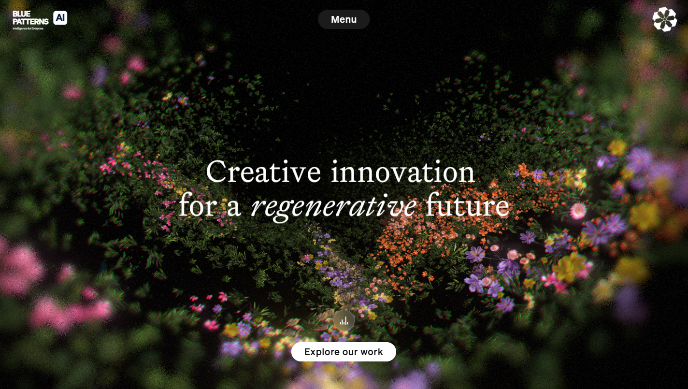
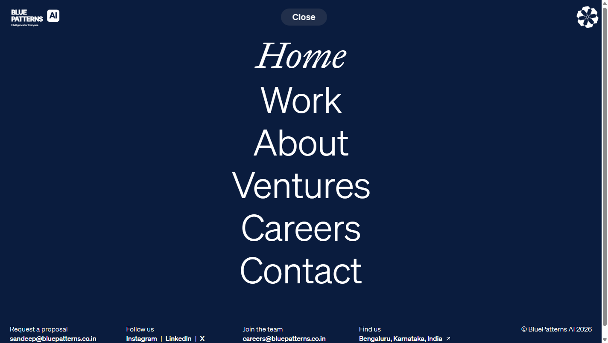

# Gladeye-R | BluePatterns AI Interactive 3D Experience

[](https://opensource.org/licenses/MIT)
[](https://threejs.org/)
[](https://www.khronos.org/webgl/)
[](https://nextjs.org/)
[](https://nodejs.org/)

An award-winning, immersive WebGL and Three.js digital brand experience crafted for **BluePatterns AI** (*Intelligence for Everyone*). The experience features a real-time procedural 3D flower valley, spline-interpolated cinematic camera paths, volumetric atmosphere, interactive soundscape, and a responsive navigation suite styled in **Royal Navy Blue** and **Light Sky Blue**.

---

## 📸 Visual Showcase

### 🌺 3D Flower Valley Real-Time WebGL Scene


### 🧭 Full-Screen Navigation Menu (Royal Navy Blue)


---

## ✨ Key Features

### 🌸 1. Procedural 3D WebGL / Three.js Landscape
- **Dense Botanical Scattering**: High-density instanced meshes simulating thousands of photorealistic flowers, grass blades, and foliage across a sculpted terrain.
- **Atmospheric Post-Processing**: Custom GLSL shaders providing depth-of-field, lens dispersion, chromatic aberration, bloom, vignette, and ambient dust particle drift.
- **Dynamic Lighting**: Real-time multi-angle illumination with seasonal light ray projections (`ray1.png`, `ray2.png`, `ray3.png`).

### 🎥 2. Spline-Guided Cinematic Camera
- **Smooth Spline Pathing**: Camera trajectories orchestrated via binary GLTF animations (`valley/camera-path07.glb`).
- **Interactive Parallax**: Camera orientation gracefully responds to cursor position, touch gestures, and scroll velocity for an organic sense of depth.

### 🎵 3. Ambient Audio Engine (`AudioControl_audioButton`)
- **Seamless Looping Soundscape**: Spatial ambient audio (`valley/audio/ge-ambient.mp3`) with automatic restart on track completion.
- **Equalizer Visualizer**: Custom SVG graphic equalizer with real-time bar height animations dynamically reflecting playback states (`is-playing` vs `is-paused`).
- **Smart Menu Fade**: Intelligent contextual fading when the full-screen menu overlay is active, ensuring zero visual occlusion of navigational content.
- **HTTP Range Streaming**: Native 206 Partial Content range header support in the local streaming server for instantaneous byte-seeking and low memory footprint.

### 💎 4. BluePatterns AI Brand Architecture
- **Vector Brand Lockup**: High-precision SVG header lockup featuring stacked bold typography (`BLUE` and `PATTERNS`), the signature squircle `[ AI ]` badge, and the `Intelligence for Everyone` mission subtitle.
- **Strict ViewBox Calibration**: Tuned internal SVG boundaries (`viewBox="-30 -35 1070 425"`) with 16px vertical viewport clearance to eliminate edge clipping on all display formats.
- **Thematic Palette**: Signature **Royal Navy Blue** (`#0A1C3E`) backdrop complemented by **Light Sky Blue** (`#7EC8E3`) interactive highlights.

### ⚡ 5. Zero-Hydration-Error Next.js Runtime
- **Synchronized React RSC Architecture**: Dehydrated DOM markup and client component flight streams (`__next_f`) are aligned node-for-node and attribute-for-attribute, ensuring completely error-free hydration with zero console exceptions.

---

## 🏗️ Architecture & Project Structure

```plaintext
Gladeye-R/
├── _next/                      # Compiled Next.js App Router static assets
│   └── static/
│       ├── chunks/             # Webpack JS bundles & Three.js engine
│       │   ├── app/            # Layout and Page client components
│       │   └── ...             # Core vendor & runtime bundles
│       ├── css/                # Tailwind & module stylesheets
│       └── media/              # Söhne & Epicene web font binaries
├── docs/
│   └── images/                 # Visual documentation & screenshot previews
│       ├── scene-loaded.png    # 3D landing scene capture
│       └── menu-open.png       # Navigation menu capture
├── valley/                     # 3D assets & media assets
│   ├── audio/
│   │   └── ge-ambient.mp3      # Looping ambient soundscape
│   ├── camera-path07.glb       # Spline camera path binary model
│   ├── dust-particle.png       # Floating particle sprite
│   ├── terrain.png             # Displacement & terrain normal map
│   └── vignette.png            # Camera lens vignette texture
├── index.html                  # Main application entry point
├── server.js                   # High-performance zero-dependency streaming server
├── favicon.ico                 # Multi-resolution ICO brand icon
├── favicon.svg                 # Scalable vector brand icon
├── package.json                # Project manifest & run scripts
├── LICENSE                     # MIT License
├── .gitignore                  # Git exclusion rules
└── README.md                   # Project documentation
```

---

## 🚀 Quick Start Guide

### Prerequisites
- [Node.js](https://nodejs.org/) (v18.0.0 or higher recommended)
- A modern WebGL 2.0-compatible web browser (Chrome, Edge, Firefox, Safari, Arc)

### 1. Clone the Repository
```bash
git clone https://github.com/Sandeep-Hipparagi/Gladeye-R.git
cd Gladeye-R
```

### 2. Start the Local Server
```bash
npm start
```
*Or directly via Node.js:*
```bash
node server.js
```

### 3. Open the Experience
Navigate to:
```
http://localhost:8080
```

To configure a custom port:
```bash
PORT=3000 npm start
```

---

## 🛠️ Tech Stack

| Technology | Purpose |
| :--- | :--- |
| **Three.js** | 3D scene graph, procedural geometry, custom shaders, and lighting |
| **WebGL 2.0** | Hardware-accelerated GPU graphics pipeline |
| **React 18** | UI component lifecycle, state orchestration, and gesture interactions |
| **Next.js App Router** | Modular component bundling and static export flight serialization |
| **Framer Motion** | Physics-based spring transitions and stagger animations |
| **Tailwind CSS** | Utility styling, responsive breakpoints, and theme variables |
| **Node.js HTTP Engine** | Range-seeking audio server and static asset delivery |

---

## 📬 Contact & Brand Inquiries

- **Request a Proposal**: [sandeep@bluepatterns.co.in](mailto:sandeep@bluepatterns.co.in)
- **Careers & Talent**: [careers@bluepatterns.co.in](mailto:careers@bluepatterns.co.in)
- **Headquarters**: [Bengaluru, Karnataka, India](https://www.google.com/maps/place/Bengaluru,+Karnataka/@12.9882597,77.4571623,70306m/data=!3m2!1e3!4b1!4m6!3m5!1s0x3bae1670c9b44e6d:0xf8dfc3e8517e4fe0!8m2!3d12.9628957!4d77.57754!16zL20vMDljMTc?entry=ttu&g_ep=EgoyMDI2MTAxOC4wIKXMDSoASAFQAw%3D%3D)

---

## 📄 License

This project is licensed under the [MIT License](LICENSE).
Copyright © 2026 BluePatterns AI. All rights reserved.
